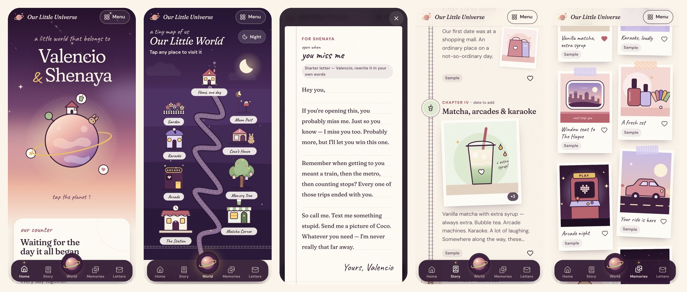

# Our Little Universe ♡

A private, interactive little world for **Valencio & Shenaya** — a scrapbook,
a storybook, a map of our places, letters for the right moments, and a sky
full of one-days.



Built with React 19, TypeScript and Vite. Mobile-first (made for iPhone),
works offline once visited, installs like an app on iPhone, Android and
computers, and — once connected to our own free Supabase project — keeps one
shared universe in sync between both of our phones and any laptop.

**Setting it up for the two of us:** follow the Dutch step-by-step guide in
[`docs/HANDLEIDING.md`](docs/HANDLEIDING.md).

---

## Run it

You need [Node.js](https://nodejs.org) 20 or newer.

```bash
npm install
npm run dev
```

Open <http://localhost:5173>.

**On your iPhone:** keep the phone on the same Wi-Fi as your computer. The dev
server prints a `Network:` address (something like `http://192.168.1.20:5173`)
— open that in Safari.

### Production build

```bash
npm run build     # type-checks, then builds into dist/
npm run preview   # serves dist/ at http://localhost:4173
```

`dist/` is a plain static site (all paths are relative), so it can be hosted
anywhere. `netlify.toml` and `vercel.json` are included (build command, caching
and security headers, `noindex`). Note that a hosted link is reachable by
anyone who has it — see [Privacy](#privacy--where-things-are-stored).

To share one universe, give the build our Supabase project — either as build
environment variables (copy `.env.example` to `.env`, or set them in Netlify):

```bash
VITE_SUPABASE_URL=https://abcdefgh.supabase.co
VITE_SUPABASE_ANON_KEY=sb_publishable_…   # the publishable / anon public key
```

…or, without rebuilding, by filling in `universe-config.json` next to
`index.html`. Only the publishable key belongs in a website: the build stops,
and the app refuses to connect, if a secret / `service_role` key is used.

### Install it as an app (any device)

The home page and **Menu → Get the app** show the right steps for the device
in hand: an **Install** button where the browser offers one (Android, Chrome,
Edge), and **Share → Add to Home Screen** on iPhone and iPad, **File → Add to
Dock** in Safari on a Mac. Installed, it opens full-screen with its own icon
and keeps working offline (the app shell and every page are cached by a
service worker after the first visit). No app store involved.

### Checks

```bash
npm test          # unit tests: date maths, merging, the sync engine with two
                  # simulated phones, config safety, and the database security
                  # rules in a real Postgres (PGlite)
npm run typecheck # TypeScript
```

---

## What's inside

| Section | What it does |
| --- | --- |
| **Opening scene** | Two stars — Valencio and Shenaya — drift together and become a little planet. Skippable; shown once per visit by default (Settings → Opening scene). |
| **Home** | Twilight hero with a planet you can tap for a little reason, the *together for* counter (years · months · days, or total days, plus the next anniversary), a note, and a scrapbook-style map of everything. |
| **Our Story** | A journey line: train tracks for the train-and-metro era, a road from the chapter where the car arrived, starlight for chapters not yet written. Chapters open like storybook pages (swipe or arrow keys), with photos, clips, a song and a writing prompt. Add, edit, reorder, favourite, delete (with undo). |
| **Memories** | Polaroid scrapbook with albums, favourites and search. Lightbox with swipe, keyboard and slideshow (optionally with our soundtrack). Pick several photos at once — they're resized and stored on the device. |
| **Our Little World** | The signature feature: an illustrated landscape where a path climbs from *the Station* (where it started) to *our home, one day*. Nine places — Matcha Corner, Arcade, Karaoke Booth, Memory Tree, Coco's House, Garden, Moon Post — each with its own little interaction. Day/dusk/night follow the clock (or tap to change). |
| **Open when…** | Envelopes with an opening animation. Letters can be on the shelf or kept as drafts, opened with a tap, by holding the wax seal, or not before a chosen date. |
| **Our Future** | Dream board (each kind of dream is a different keepsake), statuses with a small celebration when something's done, a pressure-free *One day…* sky, and time capsules sealed until a date. |
| **Little Surprises** | A jar of reasons, a gift box, a flower that blooms with today's reason, a photo with a secret on the back, a night sky whose stars draw a heart — and hidden hearts scattered around the site. All editable. |
| **Music Corner** | Record player for our soundtrack (an original music-box lullaby made for this site, or our own uploaded song). Songs with why they matter; Spotify/YouTube links play in an official embedded player on request, other links open externally. Nothing autoplays. |
| **Coco's Corner** | Coco's portrait (illustration until a photo is set), an editable *Official bunny ID*, Coco's photos and funny moments. |
| **Settings** | Names, start date, every word on the home page, colour theme (Blush, Lavender dusk, Matcha, Midnight), animation level, intro, lighting, soundtrack, backups, sample-content removal. |

### Sample content

Everything that ships with the site is a clearly labelled placeholder
(“Sample”, “Starter”), built only from details we gave — no invented dates,
conversations or promises. Chapters contain writing prompts instead.
**Settings → Our data & backups → Remove samples** clears them in one go; anything
you've edited is kept.

---

## Privacy & where things are stored

- **On each device.** Words live in `localStorage`; photos, clips and the
  uploaded song live in IndexedDB. Without a Supabase project configured,
  nothing ever leaves the device (move content with Settings → **Export with
  photos** / **Restore a backup**).
- **When shared.** With a project configured and both of us signed in, the
  universe is also stored in *our own* Supabase project: one document in
  Postgres plus a **private** storage bucket for photos. Row-level security and
  server-side functions allow exactly the two members to read and write;
  invites only work for a confirmed account with that exact email, and a
  universe holds at most two people. Each device still keeps its own copy, so
  it works offline and keeps its copy after signing out.
- **Real sign-in, no fake security.** Accounts are Supabase email + password
  accounts. The password is never stored by the app; the sign-in session is
  kept in the app's IndexedDB, not in `localStorage`. Without a project there
  is deliberately no password screen, because without a server it would only
  *look* secure.
- **What a visitor with only the link sees:** the starter version that ships
  with the site (names and sample texts) on their own device — never our own
  memories, letters or photos.
- **Keep backups.** Safari can clear storage for websites that haven't been
  opened in a while. Installed apps are much safer, and the shared copy lives
  online — but an occasional export is still the best insurance.

---

## Project structure

```
src/
  app/           App shell: routing, top bar, tab bar, menu, mini player
  data/          Types, starter content, store, actions, import/export, validation
  lib/           Dates (tested), hash router, IndexedDB media, music box synth, embeds
  components/    UI primitives (dialog, fields, toasts, confirm), media, art, music
  features/      One folder per section: home, intro, story, memories, world,
                 letters, future, surprises, music, coco, settings
  pwa/           Install detection and the per-device "Get the app" sheet
  sync/          Sharing: config, three-way merge, sync engine, Supabase backend
  styles/        Design tokens, base styles, shared UI styles
public/          Manifest, icons, service worker, universe-config.json
supabase/        schema.sql (tables, security rules, storage) and its tests
docs/            HANDLEIDING.md — the Dutch setup guide
```

The visual language lives in `src/styles/tokens.css` (palette, type, depth)
and the illustrations in `src/components/art` and `src/features/world/PlaceArt.tsx`.

---

## How sharing works

- **One document per universe.** `space_content` holds the whole universe as
  JSON with a version number. Saving sends the version it was based on; if the
  other phone saved in between, the server refuses and returns the newer copy.
  The app then merges both sides item by item (`src/sync/merge.ts`): additions
  and edits from both phones are kept, deletions are respected, and if both
  changed the same item, this device's edit wins.
- **When it syncs.** A moment after every change, on opening or returning to
  the app, when coming back online, through Supabase Realtime when the other
  phone saves, and every 90 seconds as a fallback.
- **Photos and clips** upload in the background to `universe-media/<universe
  id>/…` and download on demand on the other devices, where they're cached in
  IndexedDB.
- **Joining.** The first person creates the universe and invites the other's
  email. When the invited person signs in, they join automatically; anything
  of their own they'd already added is kept and added to the shared copy.
- **Limits.** The free Supabase plan has about 1 GB of file storage and pauses
  projects after roughly a week without any use (restoring is one click).
  Supabase's built-in email only reaches members of your own Supabase
  organisation, which is why the guide creates both accounts in the dashboard.

What was tested: the schema's security rules in a real Postgres (PGlite), the
merge and sync engine with simulated phones, and the full flow in two browsers
against a local stand-in for Supabase that runs the real schema. It has not
been run against a live Supabase project, or in Safari on a real iPhone, from
here — the first real check is following the guide.

---

## Credits

Fonts: Fraunces, DM Sans and Caveat (SIL Open Font License), self-hosted via
Fontsource. Icons: Lucide (ISC). Illustrations and the music-box tune were
made for this project.

Made with love by Valencio.
